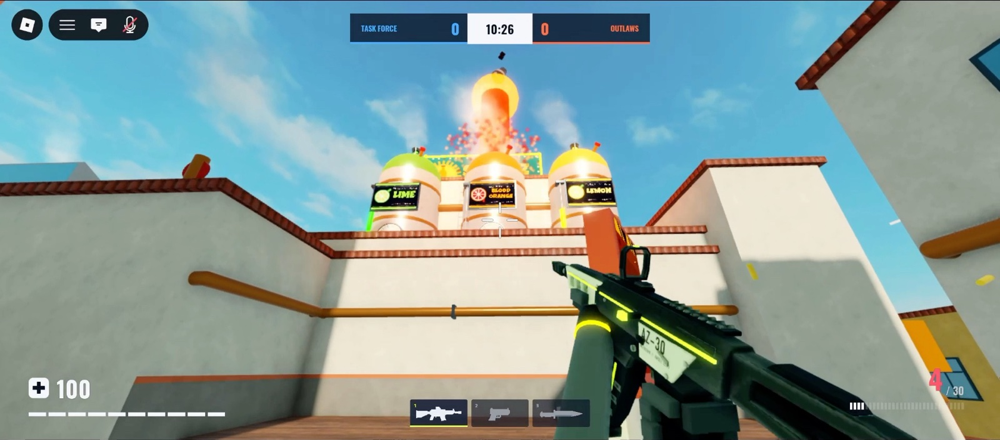
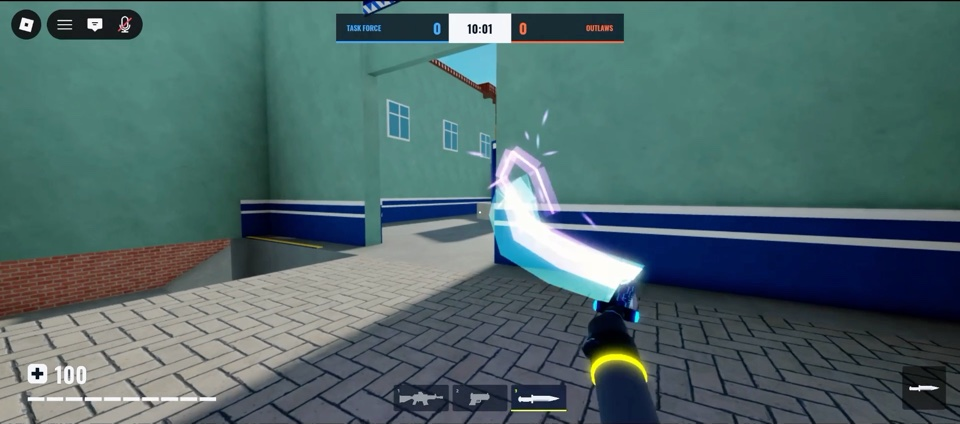
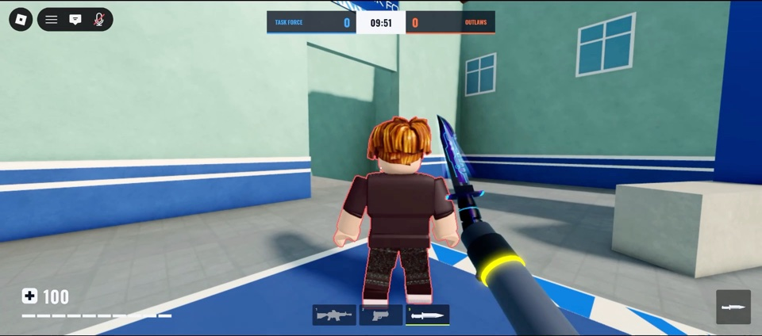
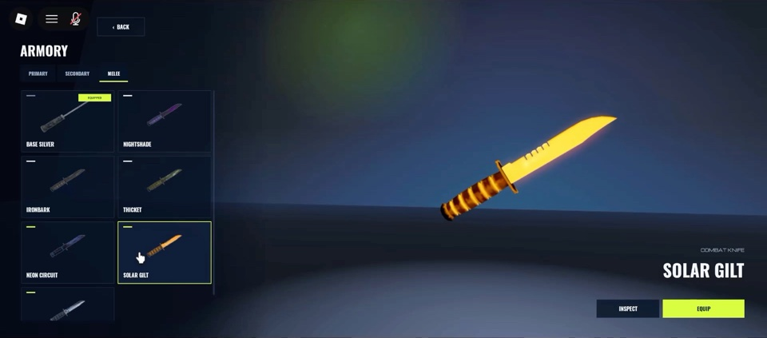

# ANGLE ZERØ

**A fast-paced multiplayer first-person shooter developed for Roblox.**

[**⬇ Download the gameplay showcase**](https://github.com/tyalcin-ucsc/ANGLE-ZERO-Showcase/releases/download/showcase-v1/ANGLE_ZERO_Gameplay_Showcase.mp4) &nbsp;·&nbsp; 1:19 &nbsp;·&nbsp; 1080p60

---

## Gameplay Showcase

  <a href="https://github.com/tyalcin-ucsc/ANGLE-ZERO-Showcase/releases/download/showcase-v1/ANGLE_ZERO_Gameplay_Showcase.mp4"><b>⬇ Download the full-quality gameplay video</b></a> (MP4, 1:19, 1080p60, 151 MB)
  &nbsp;·&nbsp;
  <a href="https://github.com/tyalcin-ucsc/ANGLE-ZERO-Showcase/releases/tag/showcase-v1">Release page</a>

The video was captured in-game from a two-player match with the game's original audio. It runs from the main menu and DEPLOY through a tour of the map, combat with all three weapons, the interactive props, the Armory and weapon inspects.

<table>
  <tr>
    <td width="33%"></td>
    <td width="33%"></td>
    <td width="33%"></td>
  </tr>
  <tr>
    <td align="center">Neon Circuit slash effects</td>
    <td align="center">Server-validated knife backstab</td>
    <td align="center">Armory finish selection</td>
  </tr>
</table>

## About the Project

ANGLE ZERØ is my personal Roblox FPS game development project. It is a team deathmatch shooter: **TASK FORCE** and **OUTLAWS** fight in timed 12-minute rounds on the Sunfizz Bottling Works map, and its systems are built and tuned for 10v10 matches.

The project focuses on:

- **Responsive movement:** sprinting, sliding and aiming that feel immediate on the client.
- **Fast combat:** short time-to-kill, clear hit and elimination feedback.
- **Weapon variety:** a rifle, a pistol and a knife, each with its own role and presentation.
- **Presentation:** custom animations, effects, sounds and a full menu flow.
- **Multiplayer systems:** gameplay decisions are made and validated on the server.

## Key Features

### Combat System

- **First-person shooting** with automatic and semi-automatic weapons, recoil, tracers, impact effects and hitmarkers.
- **Server-authoritative damage handling.** The client sends shot requests; the server re-validates timing, ammo, origin and line of sight, re-casts the rays itself and applies team rules before any damage is dealt. Each player's fire rate is enforced on the server, including under lag and forged bursts.
- **Headshot damage multipliers** (1.5×), detected by the server's own raycast rather than reported by the client.
- **Team-based combat** with friendly fire disabled, server-owned scoring, a kill feed and automatic round resets.
- **Server-side knife combat:** the server picks the target from a moving hit window and computes backstabs (50 front / 100 backstab damage).
- **Kill streaks and elimination feedback:** a killer-only elimination confirm with a five-stage streak bar and an ANGLE ZERØ signature on the fifth kill.

### Movement

- **Sprinting:** unlimited sprint with no stamina, so players keep moving.
- **Sliding:** a direction-locked slide that decelerates smoothly into a sprint, with a lowered first-person camera and a crouched pose shown to other players.
- **Aim down sights (ADS):** FOV zoom, viewmodel transition and tighter spread.
- **Fast-paced movement mechanics:** sprint, slide, ADS and weapon swaps are designed to chain without dead time.

### Weapons

- **AZ-30 Meridian rifle:** automatic primary, 30-round magazine.
- **AZ-10 Tangent pistol:** semi-automatic sidearm, 10-round magazine.
- **Neon Circuit knife:** a premium knife finish with its own equip, slash and inspect animation layers, cyan and purple circuit effects, and original sounds.
- **Weapon switching** through a three-slot hotbar, number keys and the mouse wheel.
- **Reload and inspect animations** on a scripted first-person rig.
- **Weapon skins and visual effects:** additional knife finishes (including Solar Gilt and Frostbite) with their own effects and sounds. Skins are cosmetic only and never change damage, speed or range.

### Maps and Interactions

- **Sunfizz Bottling Works:** a soda-factory arena with its own palette, decor layer, lighting and ambient audio.
- **Interactive soda tanks:** rooftop tanks build pressure from server-validated hits and burst, then refill. They reset every round.
- **Vending machine effects:** the Task Force vending machine reacts to shots and knife hits and dispenses cans.
- **Breakable bottles:** soda bottles on the factory conveyors shatter when shot.
- **Environmental details:** team spawn rooms, factory signage, string lights, moving machinery and ambient effects.

### Interface

- **Main menu:** a full-screen title over an animated space scene.
- **DEPLOY system:** the server balances teams and reserves a spawn, then plays an orbital-drop transition into the match.
- **ARMORY:** browse finishes in a lit studio, EQUIP them, and INSPECT knives in first person.
- **SETTINGS:** controls, video, audio and crosshair options.
- **Team scoreboard:** Tab scoreboard, live score and round timer, kill feed and team highlights.
- **Elimination feedback:** an ELIMINATED banner, headshot marker, streak bar and kill sound.

## Technologies

| Tool | Use in ANGLE ZERØ |
| --- | --- |
| **Roblox Studio** | Engine, level work and local multiplayer playtesting |
| **Luau** | All gameplay, server, networking and UI code |
| **Rojo** | Syncs a file-based, source-controlled project into Studio |
| **Git and GitHub** | Version control and project history |
| **Blender** | Weapon and knife asset preparation, textures and animation work |
| **Python** | Scripts that generate textures and other assets |
| **OBS Studio** | Capturing gameplay footage |

## My Role

ANGLE ZERØ is my own software engineering and game development project. I am responsible for its design, implementation, integration and testing:

- **Gameplay programming:** match flow, round states, scoring, spawning and respawning, and out-of-bounds handling.
- **Combat mechanics:** firearm validation, headshots, a server-side fire-rate limit with a lag-tolerant shot queue, and server-authoritative knife hit detection with backstabs.
- **Movement systems:** sprint, ADS interaction and the slide, including the first- and third-person presentation.
- **Multiplayer architecture:** a clear split between client presentation and server authority. Clients send requests and the server decides; cosmetic remotes are rate-limited and never treated as proof of a hit.
- **Weapon integration:** scripted first-person rigs, animation clips, effects, sounds and a cosmetic skin system with cancel-safe effect layers.
- **UI:** the main menu, DEPLOY, Armory, Settings, HUD, scoreboard and elimination feedback.
- **Overall development:** asset pipelines, performance budgets for 10v10, two-player replication testing and documentation.

## Project Status

ANGLE ZERØ is an **actively developed** Roblox FPS. The current build is playable in multiplayer test sessions; the game has **not been publicly released**.

Planned work includes earned progression, more weapons and finishes, a second map and further security hardening before launch.

The game's source code and assets are kept in a private repository. This repository is a public showcase of the project.
